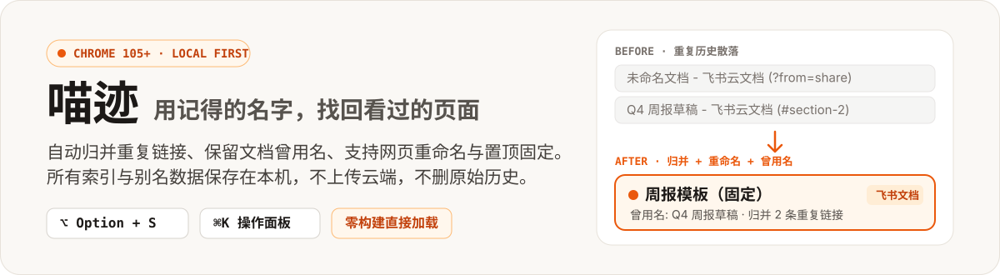

<p align="center">
  
</p>

<p align="center">
  <a href="manifest.json"></a>
  
</p>

<p align="center">
  <a href="#快速开始">快速开始</a>&nbsp;&nbsp;·&nbsp;&nbsp;
  <a href="#功能">功能</a>&nbsp;&nbsp;·&nbsp;&nbsp;
  <a href="#快捷键">快捷键</a>&nbsp;&nbsp;·&nbsp;&nbsp;
  <a href="#隐私与数据">隐私与数据</a>&nbsp;&nbsp;·&nbsp;&nbsp;
  <a href="#常见问题">常见问题</a>&nbsp;&nbsp;·&nbsp;&nbsp;
  <a href="https://github.com/0xb3i/chrome-history-dedupe/issues">反馈问题</a>
</p>

<p align="center">
  
</p>
<p align="center"><sub>使用示例数据展示已重命名、已固定、时间分组、来源标签与关键词高亮。</sub></p>

## 功能

- **标题与曾用名搜索**：输入即搜索，匹配词高亮；支持用空格组合多个关键词，也能匹配已保存的曾用名。
- **重复链接归并**：同一页面的重复 URL 自动归并，同一来源的同名页面折叠展示；其他链接可在操作面板中查看。
- **重命名与固定**：为页面起一个好记的名字，把常用页面固定到结果顶部；也可以自定义来源名称。
- **筛选与排序**：按时间、来源或是否已命名筛选，支持综合排序、访问最多、最近访问和名称排序；最近访问模式按时间分组。
- **键盘操作**：方向键选择结果，回车打开；通过 `⌘K / Ctrl+K` 操作面板完成重命名、固定、复制链接与来源筛选。

> 点击来源名称，或在操作面板中选择「只看此来源」，会筛选所有显示名称相同的来源。例如将三个不同域名都命名为「飞书云文档」后，点击任意一个即可同时筛选这三个来源。

<details>
<summary>查看操作面板截图</summary>

选中结果后按 `⌘K` / `Ctrl+K`，或右键点击结果。

<p align="center">
  
</p>

</details>

## 快速开始

需要 **Chrome 105 或更新版本**，支持 macOS、Windows 和 Linux。通过开发者模式加载项目目录即可使用，无需构建或安装 Node.js。

1. [下载 ZIP](https://github.com/0xb3i/chrome-history-dedupe/archive/refs/heads/main.zip) 并解压到固定目录，或使用 Git：

   ```bash
   git clone https://github.com/0xb3i/chrome-history-dedupe.git
   ```

2. 打开 `chrome://extensions`，开启右上角的「开发者模式」。
3. 点击「加载已解压的扩展程序」，选择包含 `manifest.json` 的项目根目录。
4. 将「喵迹」固定到工具栏，点击小猫图标或按 `Option + S` / `Alt + S` 开始搜索。

> **更新**：在原目录更新文件（Git 安装可运行 `git pull --ff-only`），再到 `chrome://extensions` 点击「重新加载」。近期改动见 [提交记录](https://github.com/0xb3i/chrome-history-dedupe/commits/main/)。

## 快捷键

| 操作 | macOS | Windows / Linux |
| --- | --- | --- |
| 打开搜索 | `Option + S` | `Alt + S` |
| 重命名当前网页 | `Option + Shift + S` | `Alt + Shift + S` |
| 打开结果的操作面板 | `⌘ + K` | `Ctrl + K` |
| 切换仅显示已命名 | `⌘ + Shift + E` | `Ctrl + Shift + E` |
| 选择结果 | `↑` / `↓` | `↑` / `↓` |
| 打开选中的页面 | `Enter` | `Enter` |

前两项可在 `chrome://extensions/shortcuts` 修改，喵迹设置页会显示实际生效的快捷键；其余快捷键在搜索面板内生效。

## 隐私与数据

- **本地处理**：历史搜索索引、页面名称、来源名称和固定状态保存在本机，不上传云端，也不跨设备同步。
- **保留原始历史**：去重只影响结果展示，不删除 Chrome 历史记录；扩展不在无痕模式中运行。
- **备份与迁移**：在搜索面板打开「筛选与排序」→「设置」，使用「导出」或「恢复」管理备份。移动加载目录或重装扩展前请先导出备份。

<details>
<summary>权限用途（完整声明见 manifest.json）</summary>

| 权限 | 用途 |
| --- | --- |
| `history` | 读取浏览历史，并在历史变化时更新本地搜索索引 |
| `storage` | 保存自定义名称、固定状态、设置和已采集标题 |
| `tabs` | 读取标签页的地址和标题，补充历史搜索所需的页面名称 |
| `webNavigation` | 跟踪页面导航与重定向，将标题关联到对应页面 |
| `activeTab` | 用户调用重命名快捷键时，临时访问当前标签页 |
| `scripting` | 在当前网页中显示重命名面板 |
| `favicon` | 通过 Chrome 的图标接口显示网站图标 |

</details>

## 常见问题

<details>
<summary>搜索范围包含网址和网页正文吗？</summary>

搜索匹配页面标题、自定义名称和已保存的曾用名，不提供网址或网页正文全文搜索。可以输入标题中的几个关键词，并用空格分隔。

</details>

<details>
<summary>为什么某个页面或曾用名搜不到？</summary>

先确认对应页面仍在 Chrome 历史记录中，再检查时间、来源和「已命名」筛选。已命名页面不受时间筛选限制，但仍依赖原始历史记录；导入备份不会恢复已经删除的 Chrome 历史。曾用名搜索依赖扩展已采集或保存的标题，无法补回安装前未记录的旧标题。

</details>

<details>
<summary>快捷键没有反应怎么办？</summary>

打开 `chrome://extensions/shortcuts`，检查「喵迹」是否已分配快捷键，并尝试换成未被系统或其他扩展占用的组合。也可以点击工具栏的小猫图标打开搜索；设置页会显示实际生效的快捷键。

</details>

## 开发与贡献

扩展使用原生 HTML、CSS 和 JavaScript，无运行时框架依赖。开发验证需要 Node.js 20.19 或更新版本：

```bash
npm ci
npm run verify
```

- **反馈问题**：在 [Issues](https://github.com/0xb3i/chrome-history-dedupe/issues) 中附上操作系统、Chrome 版本、扩展版本与复现步骤（涉及浏览记录的截图请隐去私人信息）。
- **贡献代码**：保持改动聚焦，遵循 [项目约定](AGENTS.md)，提交前运行 `npm run verify`。

## 致谢

小猫图标来自 Microsoft [Fluent Emoji](https://github.com/microsoft/fluentui-emoji)，沿用原始橙色设计，图标素材使用 [MIT 许可证](icons/LICENSE)。
